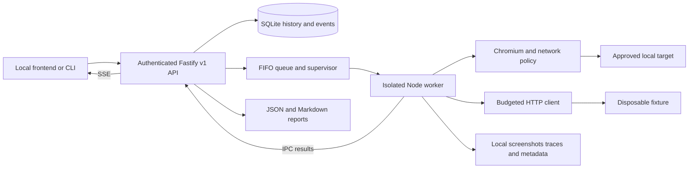

# Backend architecture

The API owns SQLite history and a bounded FIFO queue. Each active run owns a fresh Node child process. That worker owns its Chromium server, isolated browser contexts, synthetic fixture server, and fixture database. Browser failures cannot block the API event loop.

## Lifecycle and durability

`queued → preparing → running → analyzing → completed`; cancellation, deadlines, worker errors, and partial coverage produce `cancelled`, `timed_out`, `failed`, or `partially_completed`. An application defect does not itself fail the run: `completed` means the execution and report completed, and may contain confirmed findings.

SQLite WAL, `synchronous=FULL`, immediate transactions and a data-directory ownership lock protect local state. State changes and their event are committed together before subscribers receive them. Terminal transitions are idempotent; a late worker completion cannot overwrite cancellation. Each result and artifact reference is saved as it arrives, so a worker crash retains completed observations. Reports are written through temporary files before normal terminal publication.

The API has one active job by default, at most two with configuration, and at most twenty queued jobs. Workers heartbeat every 500 ms; the supervisor checks every 250 ms, uses a 10-second liveness threshold, and enforces the run deadline independently. Cancellation first requests cooperative shutdown, then force-kills the owned process tree after a two-second grace period. On Windows, the fixed internal `taskkill` invocation receives a recorded numeric PID; scenarios cannot supply a command. POSIX workers use process groups.

An abrupt API kill disconnects the worker. Tests verify the fixture listener stops and that restarting repairs interrupted history. A hard OS kill can prevent finalizers from removing temporary files; startup removes disposable fixture/trace leftovers and marks previously active runs failed. No cleanup handler can run during power loss. Completed history is retained. Queued work resumes in FIFO order after restart.

## Planning, execution and observation

Built-in recipes are versioned contracts with prerequisites, target eligibility, action descriptions, expected assertions, evidence and cleanup requirements. Custom Levels 1–2 scenarios use strict Zod schemas plus semantic validation. There is no shell, arbitrary JavaScript, file read/write, custom selector engine, or privileged fault action in that vocabulary. Engine-authored DOM checks are fixed code.

Actions, assertion outcomes, timings, expected/observed values, reproduction attempts, environment and stable artifact IDs are stored separately. A fixture failure receives one fresh-state reproduction attempt; the same failed assertion must recur to be confirmed. Custom loopback mutations are never automatically retried/replayed. Severity has a stated fixture-policy rationale; custom failures without an impact policy remain unassigned. No confidence percentage is invented.

## Data and reporting

`history.sqlite` contains local run snapshots and replayable event history. `artifacts/<run-id>/` contains UUID-named evidence, SHA-256 checksums in metadata, and `report.json` / `report.md`. Screenshots and traces are sensitive local artifacts. Reports include coverage, unexecuted work, classifications, observed facts, hypotheses, suggested remediation and required verification.

Comparisons require matching engine version, target contract, scenarios, levels and budgets. Fixture variant may differ so a faulty baseline can be compared to a clean control. Stored reports automatically use the most recent compatible completed baseline among the latest 100 runs, when available. API clients can explicitly select a baseline. A passing control proves only that those assertions passed in that run; it does not prove a proposed user-application fix works.

## Runtime and packaging

There is no frontend dependency in execution. The supervisor forks `process.execPath`, so it can use an embedded Node runtime instead of an end-user system installation. A future desktop release must bundle Node 24, production dependencies, compiled sources and the matching Playwright Chromium distribution; set `PLAYWRIGHT_BROWSERS_PATH` to that bundle. Signed Windows/macOS installers and macOS runtime verification are not implemented here. See the frontend handoff for the sidecar startup/session-file contract.

Implementation references checked during development: [Fastify validation and serialization](https://fastify.dev/docs/latest/Reference/Validation-and-Serialization/), [Playwright network interception](https://playwright.dev/docs/network), [Playwright browser server ownership](https://playwright.dev/docs/api/class-browsertype#browser-type-launch-server), [Zod JSON Schema generation](https://zod.dev/json-schema), [Node SQLite](https://nodejs.org/api/sqlite.html). The lockfile, runtime checks and executed tests are the authority for this checkout's exact versions.
